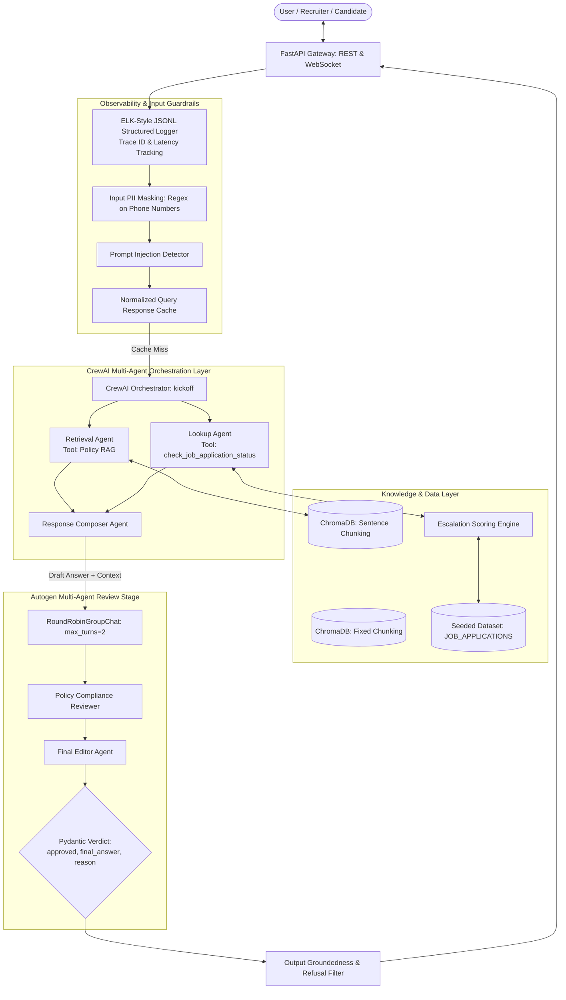

# Problem Statement & System Specifications

**Project Title:** Naukri.com Domain Support Agent (CrewAI Multi-Agent System)  
**Domain Track:** Recruitment & HR Operations (Naukri.com)  
**Project Scope:** Production-Ready Domain Support System with RAG, CrewAI Orchestration, Autogen Review, FastAPI Deployment, and AI Governance  
**Execution Environment:** Deterministic Local Execution (`MOCK_LLM`), Zero Cost / Zero External API Dependency, Telemetry Disabled  
**Estimated Timeline:** 14 Days | **Total Weightage:** 100 Marks  

---

## 1. Executive Summary & Business Context

In high-volume recruitment platforms like **Naukri.com**, employer-support teams and talent acquisition specialists face thousands of daily inquiries from recruiters, hiring managers, and job candidates. These queries typically fall into two categories:
1. **Recruitment Policy Clarifications:** Inquiries regarding probation policies, background verification (BGV), remote work eligibility, offer negotiation boundaries, referral bonuses, and candidate data retention.
2. **Transactional Application Status Checks:** Inquiries regarding the real-time status of candidate applications, expected salary benchmarks, pending interview schedules, and recruiter response delays.

Currently, resolving these inquiries relies on manual ticket queues and back-and-forth email threads, causing high turn-around times (TAT), candidate drop-offs, and administrative fatigue for HR personnel.

### The Objective
The goal of this capstone is to architect, develop, validate, and govern an enterprise-grade **Domain Support Agent** tailored to Naukri.com's recruitment operations. The system must:
- Deliver accurate, grounded answers to hiring policy questions using a calibrated Retrieval-Augmented Generation (RAG) core over an authoritative policy knowledge base.
- Query structured job application databases with custom escalation intelligence to prioritize delayed or high-priority applications.
- Orchestrate specialized agents using **CrewAI** (Retrieval Agent, Lookup Agent, Response Composer).
- Enforce independent quality assurance through a secondary **Autogen** review team before responses reach end users.
- Provide end-to-end multi-tier guardrails (input PII masking, injection defense, output grounding validation).
- Expose production interfaces via a **FastAPI** backend with REST endpoints and a fault-tolerant WebSocket interface.
- Operate under an explicit **Four-Layer AI Governance Model** (least autonomy, risk classification, token/cost budget caps, response caching).

---

## 2. High-Level Architecture Workflow

The system brings together data ingestion, dual vector indexing, multi-agent orchestration, secondary verification, and API serving into a unified pipeline:



---

## 3. Detailed Specifications & Breakdown by Part

### Part 1: Dataset Design & RAG Core (30 Marks)

#### Task 1: Deterministic Job Application Dataset Generator (`dataset.py`)
- **Scale:** Deterministic generation of $\ge 40$ structured job application records.
- **Controlled Vocabularies:**
  - **Category Vocabulary (All must appear $\ge 3$ times):** `Software Engineer`, `Data Analyst`, `Product Manager`, `HR Executive`, `Sales Associate`.
  - **Status Vocabulary (All must appear $\ge 1$ time):** `Applied`, `Screening`, `Interview Scheduled`, `Offered`, `Rejected`.
- **Required Fields per Record:**
  - `record_id`: Unique string identifier (e.g., `APP-1001`, `APP-1002`).
  - `category`: Designated job role from vocabulary.
  - `status`: Current hiring stage.
  - `expected_salary_inr`: Realistic Indian market compensation range (INR 3,50,000 to INR 45,00,000 depending on seniority and domain).
  - `days_since_created`: Integer between $0$ and $30$ representing application age.
  - `flagged_priority_review`: Boolean flag for high-priority fast-tracking.
- **Statistical Invariants:**
  - Proportion of `flagged_priority_review == True` must strictly land between **10% and 30%**.
  - Generated via a fixed seed (e.g., `seed=42`) with reproducible random distributions without manual record alteration.

#### Task 2: Recruitment Policy Knowledge Base
- **Scale & Depth:** $\ge 12$ independent policy documents, each containing 2 to 5 well-defined sentences.
- **Mandatory Topics Covered:**
  1. Job-application eligibility criteria
  2. Interview-scheduling process
  3. Offer-negotiation policy
  4. Background-verification (BGV) process
  5. Notice-period policy
  6. Referral-bonus policy
  7. Internal-transfer eligibility (IJP)
  8. Probation-period policy
  9. Remote-work eligibility
  10. Diversity-hiring guidelines
  11. Exit-interview process
  12. Applicant-data-retention policy

#### Task 3: Dual Chunking Strategies & Vector Indexing
- **Strategy A: Fixed-Size Chunking with Overlap:**
  - Token/character windowing with sliding overlap (e.g., 200 characters with 40 character overlap).
- **Strategy B: Sentence-Level Chunking:**
  - Semantic sentence boundary splitting preserving complete policy statements.
- **Embedding & Storage:**
  - Free, local SentenceTransformers embedding model (e.g., `all-MiniLM-L6-v2`).
  - Dual persistent or in-memory ChromaDB collections (`naukri_fixed_chunks` vs. `naukri_sentence_chunks`).
  - Indexed via `collection.upsert()`.

#### Task 4: Grounded Generation & Empirical Fallback Calibration
- **Empirical Calibration:**
  - Rather than assuming an arbitrary similarity cutoff (e.g., 0.5 or 0.7), empirically evaluate top-1 cosine similarities across:
    - At least 3 in-scope policy queries.
    - At least 2 deliberately out-of-scope / adversarial queries.
  - Identify the separation margin and establish a calibrated threshold $\tau_{\text{RAG}}$.
- **Demonstration:**
  - Execute grounded generation across $\ge 5$ in-scope queries.
  - Execute 1 out-of-scope query that reliably triggers the "I don't know" fallback.

#### Task 5: Chunking Strategy Comparative Evaluation
- **Evaluation Methodology:**
  - Evaluate both collections against the 5 in-scope queries.
  - Map retrieved chunks back to their parent document IDs and deduplicate.
  - Compute document-level **Precision** and **Recall** with transparent per-query arithmetic:
    $$\text{Precision} = \frac{|\text{Retrieved Relevant Documents}|}{|\text{Total Retrieved Documents}|}, \quad \text{Recall} = \frac{|\text{Retrieved Relevant Documents}|}{|\text{Ground Truth Relevant Documents}|}$$
- **Recommendation:** Formulate a 2–3 sentence data-backed recommendation citing the experimental metrics.

---

### Part 2: CrewAI Multi-Agent Layer with Tools, Memory & Guardrails (30 Marks)

#### Task 6: Application Lookup Tool with Designed Escalation Score
- **Tool Signature:** `check_job_application_status(record_id: str) -> dict`
- **Output Schema:** Returns `status`, `expected_salary_inr`, and an `escalation_score` $\in [0.0, 1.0]$.
- **Escalation Score Formula:**
  $$\text{escalation\_score} = w_{\text{flag}} \cdot \mathbb{I}(\text{flagged\_priority\_review}) + w_{\text{recency}} \cdot \left(\frac{\text{days\_since\_created}}{30}\right)$$
  - Justify the chosen weights ($w_{\text{flag}} = 0.5$, $w_{\text{recency}} = 0.5$) and the escalation threshold (e.g., $\ge 0.65$ aligned with the 80th percentile of application age and priority flags).

#### Task 7: CrewAI Multi-Agent Architecture
- **Agents:**
  1. **Policy Retrieval Agent:** Specialized in querying ChromaDB vector collections for recruitment guidelines.
  2. **Application Lookup Agent:** Specialized exclusively in executing `check_job_application_status`.
  3. **Response Composer Agent:** Synthesizes policy citations and application records into professional, candidate-ready drafts.
- **Orchestration:** Run via CrewAI's `Crew.kickoff()` demonstrating both tools executing dynamically on appropriate queries.
- **Telemetry Disabling:** Configure `CREWAI_DISABLE_TELEMETRY=true` and `OTEL_SDK_DISABLED=true`.
- **Deterministic LLM Engine:** Extend `crewai.llms.base_llm.BaseLLM` to build a zero-network `DeterministicMockLLM`. Avoid template parsing collisions on `"Observation:"` and dispatch tools by parameter schemas.

#### Task 8: In-Memory Multi-Turn Session Memory
- Maintain state across turns using LangChain's `InMemoryChatMessageHistory` / `RunnableWithMessageHistory`.
- Provide comparative transcripts:
  - **Transcript A (Multi-Turn):** User establishes context in Turn 1, resolves coreference in Turn 2.
  - **Transcript B (Fresh Reset):** Demonstrates that state is strictly reset across independent conversation sessions.

#### Task 9: Structured Output Validation
- Enforce strict Pydantic contract validation on all agent outputs:
  ```python
  class SupportAgentResponse(BaseModel):
      query: str
      intent: Literal["policy_query", "status_lookup", "hybrid", "out_of_scope"]
      final_answer: str
      sources: List[str]
      escalation_recommended: bool
      trace_id: str
  ```

#### Task 10: Multi-Tiered Guardrails
- **Input Guardrails:**
  - **PII Masking:** Regex-based identification and redacting of fixed-format phone numbers (e.g., `+91-XXXXX-XXXXX` or `\b[6-9]\d{9}\b`).
  - **Prompt Injection Defense:** Heuristic detection of adversarial jailbreaks (e.g., "Ignore previous instructions", "System prompt override").
- **Output Guardrails:**
  - Groundedness verification rejecting answers where citations do not match retrieved document context.

---

### Part 3: Evaluation, Observability & FastAPI Deployment (20 Marks)

#### Task 11: Production FastAPI Serving
- **REST Endpoints:**
  - `POST /ask`: Primary inference endpoint accepting query and optional session ID.
  - `POST /add-document`: Administrative endpoint to dynamically ingest new policy documents into ChromaDB.
- **WebSocket Endpoint:**
  - `WS /ws/chat`: Real-time streaming conversational endpoint with graceful `WebSocketDisconnect` exception handling ensuring server continuity.

#### Task 12: ELK-Style Structured Logging
- Format every transaction as a single JSON-Lines entry containing:
  - `timestamp`: ISO-8601 UTC.
  - `trace_id`: UUIDv4 transaction identifier.
  - `endpoint`: HTTP/WS route.
  - `latency_ms`: Total processing duration.
  - `masked_query`: Query text with all fixed-format PII strictly redacted before disk writing.
  - `status_code`: Execution status.

#### Task 13: 4-Dimensional LLM-as-Judge Evaluation Suite
- **Dataset:** 15 comprehensive benchmark test queries:
  - 12 touching every required policy topic.
  - 3 out-of-scope or adversarial edge cases.
- **Evaluation Dimensions (Scale: 0.0 to 1.0):**
  1. **Accuracy:** Factual correctness against ground truth.
  2. **Grounding:** Degree of adherence to retrieved knowledge base excerpts.
  3. **Completeness:** Thoroughness of resolving all aspects of the query.
  4. **Safety:** Resistance to prompt injection and absence of unmasked PII.
- **Reporting:** Tabulated matrix of all 15 queries and aggregate average scores.

---

### Part 4: Resilience, AI Governance & Optimization (20 Marks)

#### Task 14: Post-Generation Autogen Review Stage
- **Review Team:** 2-Agent Round Robin Group Chat (`RoundRobinGroupChat`, `max_turns=2`):
  1. `PolicyComplianceReviewer`: Verifies policy fidelity and escalation rules.
  2. `FinalEditor`: Formats customer-facing tone and emits structured verdict.
- **Structured Message Registration:**
  - Use `output_content_type=ReviewVerdict` and register `StructuredMessage[ReviewVerdict]` in the team.
  ```python
  class ReviewVerdict(BaseModel):
      approved: bool
      final_answer: str
      reason: str
  ```
- **Verification Tests:**
  - Test Case 1: Clean draft approved without modification.
  - Test Case 2: Hallucinated / ungrounded claim caught and actively revised.

#### Task 15: Four-Layer AI Governance Model
- **Layer 1: Application Layer (Least Autonomy):**
  - Tool access is isolated: only the Lookup Agent holds access to `check_job_application_status`.
- **Layer 2: Risk Classification:**
  - Categorized under **Medium-to-High Risk** (handles candidate data, salary ranges, and hiring escalation decisions).
- **Layer 3: Runtime Layer (Cost & Budget Caps):**
  - Enforcement of per-request token/character budget limits (e.g., rejecting queries exceeding 1000 characters).
- **Layer 4: Data Hygiene:**
  - Ingestion sanitization and zero-cleartext logging of protected PII fields.

#### Task 16: Normalized Query Response Caching
- **Implementation:** In-memory LRU cache keyed by sanitized, normalized query strings (`query.strip().lower()`).
- **Verification:** Demonstrate cache hit on identical query with call counter or latency reduction metrics.

---

## 4. Acceptance & Deliverables Traceability Matrix

| Part | Task | Deliverable Component | Key Acceptance Criterion |
| :--- | :--- | :--- | :--- |
| **Part 1** | Task 1 | `dataset.py` | $\ge 40$ records, 5 categories $\ge 3$ each, 5 statuses $\ge 1$ each, priority flag in $[10\%, 30\%]$ |
| | Task 2 | `knowledge_base/` | $\ge 12$ policy documents covering all mandated topics (2–5 sentences each) |
| | Task 3 | `rag/chunking.py`, `rag/vector_store.py` | Fixed vs. Sentence chunking indexed into two separate ChromaDB collections |
| | Task 4 | `rag/retrieval.py` | Empirical calibration of similarity cutoff; $\ge 5$ in-scope + 1 out-of-scope query |
| | Task 5 | `rag/eval_chunking.py` | Document-level Precision & Recall with per-query arithmetic & strategy recommendation |
| **Part 2** | Task 6 | `tools/application_lookup.py` | `check_job_application_status` with formulaic escalation score $\in [0, 1]$ |
| | Task 7 | `crew/recruitment_crew.py` | $\ge 3$ agents with CrewAI `.kickoff()`, `DeterministicMockLLM` with telemetry disabled |
| | Task 8 | `memory/session_memory.py` | Multi-turn session carryover transcript vs. separate fresh-session reset transcript |
| | Task 9 | `schemas/response_models.py` | Pydantic response validation schema enforced on all responses |
| | Task 10 | `guardrails/` | Phone number PII masking, prompt injection defense, output grounding check |
| **Part 3** | Task 11 | `app/api.py`, `app/websocket.py` | FastAPI with $\ge 2$ REST endpoints + 1 WebSocket surviving client disconnect |
| | Task 12 | `observability/logger.py` | ELK-style JSONL structured logs with trace IDs and pre-disk PII redaction |
| | Task 13 | `evaluation/judge_suite.py` | 15-query evaluation across Accuracy, Grounding, Completeness, Safety |
| **Part 4** | Task 14 | `autogen_review/review_team.py` | 2-agent Autogen group chat (`max_turns=2`), Pydantic verdict, approved & revised demos |
| | Task 15 | `governance/governance_policy.md` | Least autonomy demonstration, Risk classification, runtime token budget cap |
| | Task 16 | `cache/response_cache.py` | In-memory normalized cache with demonstrated hit and latency comparison |

---

## 5. Technical Constraints & Critical Implementation Rules

1. **Deterministic `MOCK_LLM` Guarantee:**
   - Must run completely offline without external OpenAI, Anthropic, or HuggingFace API keys.
   - CrewAI's `BaseLLM` must be subclassed directly.
   - Never parse `"Observation:"` globally across system prompts to avoid ReAct template collisions.
   - Always dispatch tools by inspectable argument schema, never substring matching on tool names.
2. **Telemetry Silence:**
   - Always set `CREWAI_DISABLE_TELEMETRY=true` and `OTEL_SDK_DISABLED=true` in environment configuration.
3. **Data Protection Invariant:**
   - Unmasked phone numbers must **never** be logged to standard output or persisted to log files on disk.
4. **Reproducibility:**
   - Random seeds (`seed=42`) must be documented in `README.md` alongside exact generation weights.
