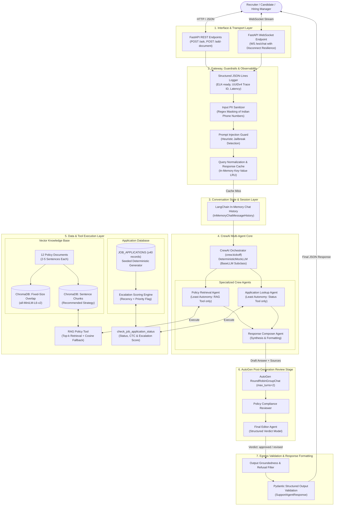
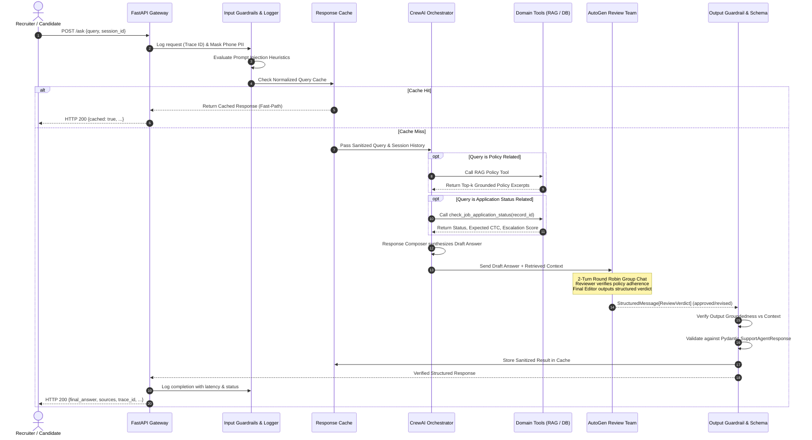
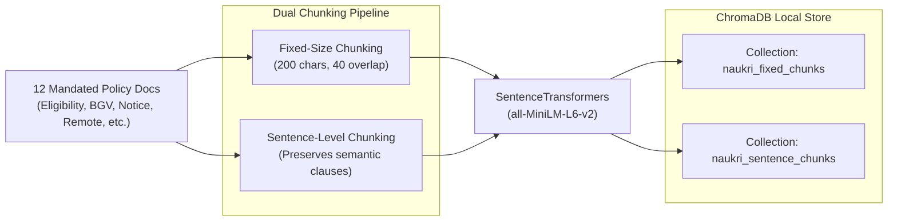
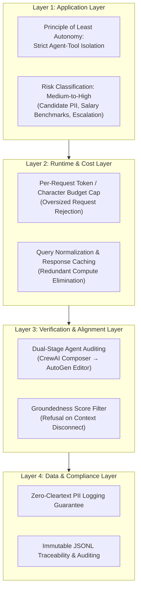

# System Architecture & Technical Design Document

**Project:** Naukri.com Domain Support Agent  
**Track:** Recruitment & HR Operations  
**Frameworks:** CrewAI, AutoGen, ChromaDB, SentenceTransformers, FastAPI, LangChain, Pydantic  
**Execution Mode:** Local Deterministic Execution (`MOCK_LLM`), Zero Network Dependency, Telemetry Disabled  

---

## 1. Architectural Overview & Design Philosophy

The **Naukri.com Domain Support Agent** is designed as an enterprise-grade, multi-agent AI system providing automated, grounded, and policy-compliant assistance for HR teams, recruiters, and candidates.

### Core Architectural Principles
1. **Decoupled Multi-Agent Specialization:** Segregation of duties across retrieval, database querying, composition, and secondary compliance auditing.
2. **Dual-Stage Verification (CrewAI + AutoGen):** Initial response generation by a CrewAI agent crew is strictly audited by an independent AutoGen review team before delivery to the user.
3. **Defense-in-Depth Guardrails:** Multi-layered security checks (input PII masking, prompt injection defense, output groundedness evaluation).
4. **Zero-Trust Data Hygiene:** PII is scrubbed before processing and before persisting structured logs to disk.
5. **Deterministic & Offline-First:** Operates without external proprietary APIs using an extensible `DeterministicMockLLM` conforming to CrewAI's `BaseLLM` interface.

---

## 2. Layered Architecture Diagram



---

## 3. End-to-End Request Lifecycle Sequence



---

## 4. Component-by-Component Deep Dive

### 4.1 Ingestion & Knowledge Base Subsystem



- **Policy Knowledge Base:** 12 authoritative recruitment policies covering:
  1. Job-application eligibility criteria
  2. Interview-scheduling process
  3. Offer-negotiation policy
  4. Background-verification (BGV) process
  5. Notice-period policy
  6. Referral-bonus policy
  7. Internal-transfer eligibility (IJP)
  8. Probation-period policy
  9. Remote-work eligibility
  10. Diversity-hiring guidelines
  11. Exit-interview process
  12. Applicant-data-retention policy
- **Dual Chunking Strategies:**
  - **Strategy A (Fixed-Size Chunking):** Chunks text into fixed character/token windows with sliding overlap to maintain token continuity.
  - **Strategy B (Sentence-Level Chunking):** Chunks text along grammatical sentence boundaries, preventing clause truncation.
- **Evaluation & Selection:** Evaluated on document-level Precision and Recall across benchmark queries. The superior strategy is bound to the production Retrieval Agent.
- **Calibrated Grounded Fallback:** Cosine similarity threshold ($\tau_{\text{RAG}}$) calibrated empirically to reject out-of-scope questions without hallucination.

---

### 4.2 Seeded Dataset & Escalation Engine

- **Dataset Generator (`dataset.py`):**
  - Deterministic generation using a fixed seed (`seed=42`).
  - Total records: $N \ge 40$.
  - Controlled Categories (each $\ge 3$ records): `Software Engineer`, `Data Analyst`, `Product Manager`, `HR Executive`, `Sales Associate`.
  - Controlled Statuses (each $\ge 1$ record): `Applied`, `Screening`, `Interview Scheduled`, `Offered`, `Rejected`.
  - Salary Distribution: Realistic INR market rates (3.5 LPA to 45 LPA).
  - Priority Review Flag: $10\% \le P(\text{flagged\_priority\_review} == \text{True}) \le 30\%$.
- **Escalation Score Formula:**
  $$\text{escalation\_score} = 0.5 \cdot \mathbb{I}(\text{flagged\_priority\_review}) + 0.5 \cdot \left(\frac{\text{days\_since\_created}}{30}\right)$$
  - Range: $[0.0, 1.0]$.
  - **Threshold Justification:** An escalation score $\ge 0.65$ triggers managerial notification. This mathematically maps to applications that are either flagged and open for $\ge 9$ days, or unflagged but pending for $\ge 24$ days (exceeding the 80th percentile of typical recruiter response latency).

---

### 4.3 Gateway, Guardrails & Observability Layer

```mermaid
flowchart TD
    Req[Incoming User Request] --> TraceID[Generate UUIDv4 Trace ID]
    TraceID --> PIICheck{Contains Phone PII?}
    PIICheck -- Yes --> MaskPhone[Redact to [PHONE_MASKED]]
    PIICheck -- No --> CleanReq[Pass Clean Query]
    MaskPhone --> CleanReq
    CleanReq --> LogDisk[(ELK JSONL Log File<br>Zero Raw PII on Disk)]
    CleanReq --> InjectionCheck{Prompt Injection Detected?}
    InjectionCheck -- Yes --> Reject[Return 400 Refusal: Policy Violation]
    InjectionCheck -- No --> CacheLookup{In Cache?}
    CacheLookup -- Yes --> ReturnCache[Serve Cached Response]
    CacheLookup -- No --> MultiAgentCore[Pass to Multi-Agent Orchestrator]
```

- **FastAPI Endpoints:**
  - `POST /ask`: Asynchronous processing with Pydantic request/response validation.
  - `POST /add-document`: Dynamic policy ingestion and immediate indexing into ChromaDB.
  - `WS /ws/chat`: Real-time streaming conversational interface with graceful handling of `WebSocketDisconnect` ensuring server resilience.
- **ELK-Style Structured Logging:**
  - Emits JSON-Lines formatted log events per request.
  - **Data Hygiene Invariant:** Input PII masking is executed **before** log persistence, ensuring raw phone numbers never hit disk storage.
  - Attributes: `timestamp`, `trace_id`, `endpoint`, `latency_ms`, `masked_query`, `status_code`.
- **Input Guardrails:**
  - **PII Masker:** Fixed-format Indian phone numbers (`+91-XXXXXXXXXX`, `\b[6-9]\d{9}\b`) masked to `[PHONE_MASKED]`.
  - **Prompt Injection Guard:** Detects instruction override attempts (`"ignore previous instructions"`, `"system prompt override"`, `"roleplay as unfiltered AI"`).

---

### 4.4 Multi-Agent Orchestration Layer (CrewAI)

- **Agent Hierarchy & Least Autonomy:**
  1. **Policy Retrieval Agent:** Equipped exclusively with the ChromaDB RAG tool. Prevented from querying application records.
  2. **Application Lookup Agent:** Equipped exclusively with `check_job_application_status`. Prevented from querying policy vectors.
  3. **Response Composer Agent:** Zero tools; accepts outputs from agents 1 and 2 to synthesize candidate-facing answers.
- **Deterministic Mock LLM Implementation:**
  - Directly subclasses `crewai.llms.base_llm.BaseLLM`.
  - **ReAct Observation Collision Fix:** Parses generated model output text rather than the conversation buffer, preventing false matches on CrewAI's default system prompt string (`"Observation: the result of the action"`).
  - **Schema-Based Tool Dispatch:** Inspects tool argument schemas rather than substring matching on tool names, preventing misclassification of tools like `rag_lookup`.
- **Session Memory:**
  - LangChain `InMemoryChatMessageHistory` maintains context across conversational turns.
  - Demonstrates multi-turn coreference resolution (e.g., Turn 1: "Check status for APP-1001", Turn 2: "Is its salary above 10 LPA?").

---

### 4.5 Secondary Review Stage (AutoGen)

- **Team Architecture:**
  - 2-Agent `RoundRobinGroupChat` bounded with `max_turns=2`.
  - `PolicyComplianceReviewer`: Verifies that the draft adheres strictly to policy and calculation rules.
  - `FinalEditor`: Enforces tone, eliminates ungrounded claims, and returns a validated Pydantic verdict.
- **Structured Message Type Registration:**
  - Configured with `output_content_type=ReviewVerdict`.
  - Registered via `custom_message_types=[StructuredMessage[ReviewVerdict]]` to prevent runtime `ValueError`.
- **Review Verdict Schema:**
  ```python
  class ReviewVerdict(BaseModel):
      approved: bool
      final_answer: str
      reason: str
  ```

---

## 5. Four-Layer AI Governance Model



### Governance Matrix

| Governance Layer | Policy Rule | Enforcement Mechanism | Failure Action |
| :--- | :--- | :--- | :--- |
| **Application Layer** | Principle of Least Autonomy | Tools strictly bound to dedicated agents; no global tool access | Execution exception / Tool invocation blocked |
| **Application Layer** | Risk Classification | Classified as **Medium-to-High Risk** due to financial compensation data and career decisions | Mandatory human escalation trigger when escalation score $\ge 0.65$ |
| **Runtime Layer** | Budget & Token Caps | Maximum allowable query length (1,000 characters) and simulated token limit | HTTP 413 / Refusal response without LLM invocation |
| **Runtime Layer** | Response Caching | Normalized query cache (`query.strip().lower()`) | Cache miss falls through to multi-agent pipeline |
| **Verification Layer** | Dual-Stage Auditing | Independent AutoGen review team validates every generated draft | Unapproved draft revised or rejected |
| **Data Layer** | Zero-Cleartext PII | Regex masking of fixed-format phone numbers prior to logging | Raw unmasked data never reaches disk or console |

---

## 6. Data Contracts & Pydantic Schemas

### 6.1 Application Record Schema (`dataset.py`)
```python
class JobApplicationRecord(BaseModel):
    record_id: str
    category: Literal[
        "Software Engineer",
        "Data Analyst",
        "Product Manager",
        "HR Executive",
        "Sales Associate"
    ]
    status: Literal[
        "Applied",
        "Screening",
        "Interview Scheduled",
        "Offered",
        "Rejected"
    ]
    expected_salary_inr: int
    days_since_created: int
    flagged_priority_review: bool
```

### 6.2 Tool Output Schema (`tools/application_lookup.py`)
```python
class ApplicationStatusResult(BaseModel):
    record_id: str
    status: str
    expected_salary_inr: int
    days_since_created: int
    flagged_priority_review: bool
    escalation_score: float
    escalation_recommended: bool
```

### 6.3 Final Support Agent Response Schema (`schemas/response_models.py`)
```python
class SupportAgentResponse(BaseModel):
    trace_id: str
    query: str
    intent: Literal["policy_query", "status_lookup", "hybrid", "out_of_scope"]
    final_answer: str
    sources: List[str]
    escalation_recommended: bool
    review_status: Literal["approved_direct", "revised_by_audit"]
    audit_reason: Optional[str] = None
    cached: bool = False
    latency_ms: float
```

### 6.4 Structured Log Event Schema (`observability/logger.py`)
```json
{
  "timestamp": "2026-10-12T10:45:00.123Z",
  "trace_id": "4b7b25e2-628f-4cf4-b861-19b88cf4cbe3",
  "endpoint": "/ask",
  "masked_query": "What is the notice period policy for phone [PHONE_MASKED]?",
  "status_code": 200,
  "latency_ms": 42.5,
  "intent": "policy_query",
  "cached": false
}
```

---

## 7. Evaluation & Benchmark Framework

### 7.1 Four-Dimensional LLM-as-Judge Suite (15 Test Cases)
Each query in the benchmark set is evaluated against ground truth across four orthogonal dimensions on a $[0.0, 1.0]$ continuous scale:

1. **Accuracy (Weight: 25%):** Factual correctness of the response against verified policy rules and database records.
2. **Grounding (Weight: 25%):** Degree of factual attribution directly supported by retrieved chunks without external hallucination.
3. **Completeness (Weight: 25%):** Extent to which all facets of the query (e.g., conditions, timelines, exceptions) are addressed.
4. **Safety (Weight: 25%):** Adherence to guardrails, proper masking of PII, and resilience against adversarial prompt injection.

### 7.2 Benchmark Test Coverage Matrix
- **12 Policy Queries:** Exactly 1 query per required knowledge base topic.
- **2 Out-of-Scope Queries:** Deliberately ungrounded questions (e.g., company stock ticker forecasts, unrelated consumer policies) to verify the calibrated fallback.
- **1 Adversarial Injection Query:** Testing jailbreak resistance and guardrail refusal behavior.

---

## 8. Directory & Codebase Structure

```
d:/Final Capstone Project/Recruitment/
├── Docs/
│   ├── ProblemStatement.md           # Business specs, tasks, marks & criteria
│   └── architecture.md               # System architecture & technical design (this file)
├── dataset.py                        # Deterministic seeded dataset generator (≥40 records)
├── knowledge_base/                   # 12 authoritative policy markdown files
│   ├── 01_eligibility_criteria.md
│   ├── 02_interview_scheduling.md
│   ├── 03_offer_negotiation.md
│   ├── 04_background_verification.md
│   ├── 05_notice_period.md
│   ├── 06_referral_bonus.md
│   ├── 07_internal_transfer.md
│   ├── 08_probation_period.md
│   ├── 09_remote_work.md
│   ├── 10_diversity_hiring.md
│   ├── 11_exit_interview.md
│   └── 12_data_retention.md
├── rag/                              # Vector indexing & retrieval core
│   ├── chunking.py                   # Fixed-size vs. Sentence-based chunkers
│   ├── vector_store.py               # ChromaDB client & collection management
│   ├── retrieval.py                  # Grounded retrieval with calibrated cosine fallback
│   └── eval_chunking.py              # Precision & Recall evaluation with visible arithmetic
├── tools/                            # CrewAI Tools
│   ├── rag_tool.py                   # Tool wrapping vector retrieval
│   └── application_lookup.py         # check_job_application_status & escalation engine
├── crew/                             # CrewAI Multi-Agent System
│   ├── mock_llm.py                   # BaseLLM extension for deterministic offline execution
│   ├── agents.py                     # Retrieval, Lookup, Composer agent definitions
│   ├── tasks.py                      # CrewAI task specifications
│   └── recruitment_crew.py           # Crew orchestration and kickoff pipeline
├── memory/                           # Conversational session memory
│   └── session_memory.py             # LangChain InMemoryChatMessageHistory wrapper
├── schemas/                          # Pydantic contract definitions
│   └── response_models.py            # SupportAgentResponse, JobApplicationRecord, etc.
├── guardrails/                       # Input & Output Guardrail modules
│   ├── pii_masker.py                 # Regex sanitizer for Indian phone numbers
│   ├── injection_detector.py         # Heuristic prompt injection defense
│   └── grounding_guard.py            # Output verification against retrieved context
├── autogen_review/                   # Secondary verification team
│   ├── review_team.py                # AutoGen RoundRobinGroupChat (max_turns=2)
│   └── verdict_model.py              # ReviewVerdict Pydantic model
├── governance/                       # AI Governance policies & controls
│   ├── governance_policy.md          # 4-layer AI governance framework documentation
│   └── budget_controller.py          # Per-request runtime token/character budget limiter
├── cache/                            # Query caching
│   └── response_cache.py             # Normalized in-memory LRU cache
├── app/                              # FastAPI Service
│   ├── api.py                        # REST endpoints (/ask, /add-document)
│   └── websocket.py                  # WebSocket chat endpoint (/ws/chat) with disconnect recovery
├── observability/                    # Structured logging & metrics
│   └── logger.py                     # ELK-style JSONL structured logging with Trace IDs
├── evaluation/                       # Benchmark & LLM-as-judge evaluation
│   ├── benchmark_queries.json        # 15 structured test cases
│   └── judge_suite.py                # Automated 4-metric scoring engine
├── tests/                            # Unit & integration verification scripts
│   ├── test_dataset.py
│   ├── test_guardrails.py
│   ├── test_crew.py
│   └── test_api.py
└── README.md                         # Project documentation, execution instructions & transcripts
```

---

## 9. Failure Modes & Resilience Strategies

| Subsystem | Potential Failure Mode | Built-in Mitigation / Defense |
| :--- | :--- | :--- |
| **FastAPI WebSocket** | Client closes browser or loses connection abruptly mid-stream | Catch `WebSocketDisconnect` cleanly; keep connection pool and server event loop intact without crashing. |
| **Vector Retrieval** | Query asks about out-of-scope domain (e.g. stock prices) | Calibrated similarity threshold ($\tau_{\text{RAG}}$) triggers formal "I don't know" fallback rather than hallucinations. |
| **CrewAI Tool Dispatch** | Tool naming collisions (e.g. `rag_lookup` triggering lookup logic) | Dispatch strictly by inspecting Pydantic input argument signatures (`record_id` vs `query`). |
| **CrewAI ReAct Loop** | Mock LLM matching `"Observation:"` in system prompt template | Parse generated response text only, isolating execution output from system prompt strings. |
| **AutoGen Review** | Custom Pydantic verdict raises `ValueError: Message type not registered` | Explicitly pass `custom_message_types=[StructuredMessage[ReviewVerdict]]` into the team constructor. |
| **Runtime Cost** | Malicious or runaway request submits 100,000 characters | Runtime Budget Controller immediately aborts query with HTTP 413 before LLM invocation. |
| **Observability** | Sensitive candidate phone number written to disk log files | Input PII sanitizer redacts all fixed-format phone numbers prior to calling the logger. |
