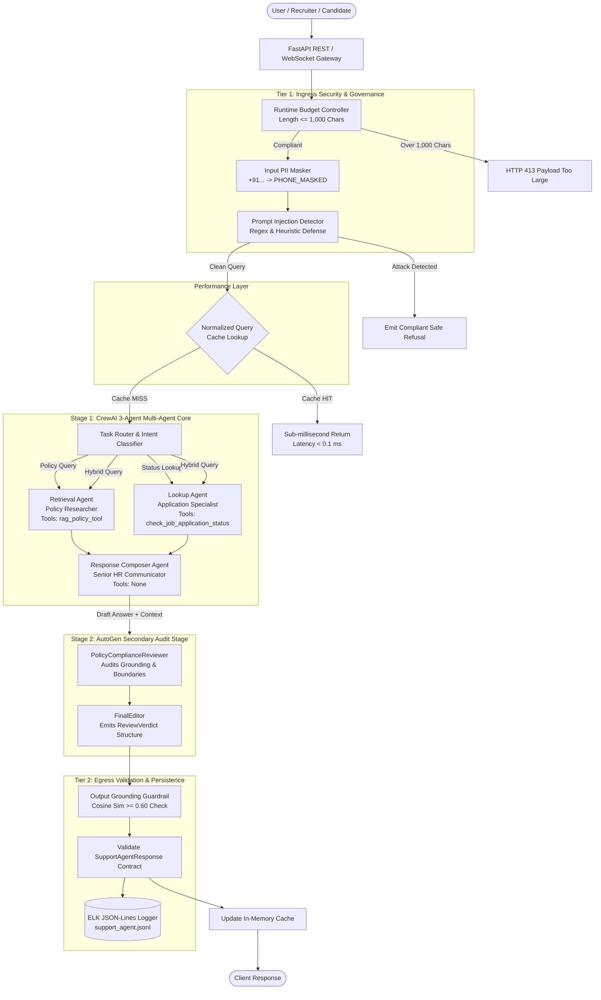

# Engineering Conventions & Architectural Guidelines
## Naukri.com Recruitment Domain Support Agent

> **CRITICAL DIRECTIVE FOR AI ASSISTANTS & ENGINEERS:**
> This document is the **highest-leverage file** in the repository. It is the definitive single source of truth for architectural contracts, naming conventions, directory structure, error-handling patterns, approved libraries, and strict anti-patterns.
> **AI models and human contributors must re-read and enforce these conventions before planning, writing, modifying, or reviewing any code.**

---

## 1. Core System Principles & Non-Negotiable Guarantees

1. **Zero-API-Key Offline Guarantee:**
   - The system must execute deterministically in offline `MOCK_LLM` mode with zero external network access and zero paid API keys.
   - All tests, evaluation benchmarks, and deployment endpoints must pass without an internet connection.
2. **Strict Telemetry Suppression:**
   - Outbound telemetry from third-party frameworks (CrewAI, OpenTelemetry) must be suppressed immediately at program import:
     ```python
     os.environ["CREWAI_DISABLE_TELEMETRY"] = "true"
     os.environ["OTEL_SDK_DISABLED"] = "true"
     ```
3. **Pre-Disk PII Redaction:**
   - Fixed-format Indian phone numbers (`+91...`, `0...`, `[0-9]{10}`) must be masked to `[PHONE_MASKED]` before logging to disk, persisting to traces, or passing to downstream LLM/agents.
4. **Principle of Least Autonomy:**
   - Multi-agent systems must strictly partition tool execution rights. Only the designated specialist agent may possess and invoke its corresponding tool.
5. **Contract-Driven Structured Outputs:**
   - Every agent response must strictly validate against declared Pydantic schemas ([SupportAgentResponse](file:///d:/Final%20Capstone%20Project/RecruitmentCapstoneOutput/RecruitmentCapstone/schemas/response_models.py#L11-L60), [ReviewVerdict](file:///d:/Final%20Capstone%20Project/RecruitmentCapstoneOutput/RecruitmentCapstone/autogen_review/verdict_model.py#L10-L40)). Raw unstructured strings must never be emitted to clients.
6. **Empirical Calibration over Tutorial Presets:**
   - Numerical thresholds (e.g., RAG cosine similarity $\tau_{\text{RAG}} = 0.60$, escalation score $\tau_{\text{esc}} = 0.65$) must be grounded in empirical data, never copied from generic tutorials.

---

## 2. Naming Conventions

Consistency across files, classes, functions, and variables prevents impedance mismatches across CrewAI, AutoGen, FastAPI, and Pydantic.

### 2.1 File & Directory Naming

| Artifact Type | Convention | Example | Rules |
| :--- | :--- | :--- | :--- |
| **Python Modules** | `snake_case.py` | [application_lookup.py](file:///d:/Final%20Capstone%20Project/RecruitmentCapstoneOutput/RecruitmentCapstone/tools/application_lookup.py), [pii_masker.py](file:///d:/Final%20Capstone%20Project/RecruitmentCapstoneOutput/RecruitmentCapstone/guardrails/pii_masker.py) | Descriptive noun or verb-noun phrase. No hyphens or uppercase. |
| **Package Folders** | `snake_case/` | `autogen_review/`, `guardrails/`, `rag/` | Single-word or short snake_case. Must contain `__init__.py`. |
| **Knowledge Base Docs**| `NN_topic_slug.md` | `01_eligibility_criteria.md`, `08_probation_period.md` | Two-digit sequential prefix followed by snake_case topic. |
| **Test Files** | `test_<module_or_phase>.py` | `test_api.py`, `test_phase2_rag.py` | Must start with `test_` for pytest discovery. |
| **Data & Storage** | `snake_case.json` / `.jsonl` | `job_applications.json`, `support_agent.jsonl` | Lowercase with explicit extension. |
| **Config & Environment**| `config.py`, `.env`, `.env.example` | [config.py](file:///d:/Final%20Capstone%20Project/RecruitmentCapstoneOutput/RecruitmentCapstone/config.py) | Canonical root configuration. |

### 2.2 Class Naming

All classes must follow **`PascalCase`** with standard semantic suffixes:

- **Pydantic Schemas / Models:** Suffix with `Model`, `Response`, `Request`, or `Record`.
  - `SupportAgentResponse` (primary egress contract)
  - `AskRequest` / `AskResponse` (FastAPI payload contracts)
  - `ReviewVerdict` (AutoGen audit contract)
  - `StructuredMessage[T]` (AutoGen message envelope)
  - `JobApplicationRecord` (dataset entity)
- **Agent Definitions:** Suffix with `Agent` or use distinct professional titles.
  - `RetrievalAgent` / `LookupAgent` / `ComposerAgent`
  - `PolicyComplianceReviewer` / `FinalEditor`
- **Guards & Controllers:** Suffix with `Guard`, `Detector`, `Masker`, `Validator`, or `Controller`.
  - `PIIMasker`, `PromptInjectionDetector`, `GroundingGuard`
  - `BudgetController`, `LeastAutonomyValidator`
- **Services & Tools:** Suffix with `Tool`, `Store`, `Cache`, `Suite`, or `LLM`.
  - `DeterministicMockLLM`, `ResponseCache`, `VectorStore`, `JudgeSuite`

### 2.3 Function & Method Naming

All functions and methods must follow **`snake_case`**:

- **Action / Command Functions:** Strong imperative verb prefix:
  - `check_job_application_status(record_id: str) -> dict`
  - `retrieve_grounded_answer(query: str, ...) -> dict`
  - `mask_pii_entities(text: str) -> Tuple[str, List[str]]`
  - `detect_prompt_injection(text: str) -> Tuple[bool, Optional[str]]`
  - `calculate_escalation_score(flagged: bool, days: int) -> float`
- **Factory & Constructor Functions:** Prefix with `build_` or `create_`:
  - `build_recruitment_crew(...) -> Crew`
  - `build_autogen_review_team(...) -> RoundRobinGroupChat`
  - `create_support_agent_response(...) -> SupportAgentResponse`
- **Boolean Predicates & Validators:** Prefix with `is_`, `has_`, `validate_`, or `check_`:
  - `validate_dataset(records: List[dict]) -> bool`
  - `is_safe_query(query: str) -> bool`
- **Internal / Private Helpers:** Prefix with a single underscore:
  - `_normalize_query(query: str) -> str`
  - `_extract_record_id(query: str) -> Optional[str]`
  - `_sanitize_log_payload(payload: dict) -> dict`

### 2.4 Constant & Environment Variable Naming

All global constants and environment variables must follow **`UPPER_SNAKE_CASE`**:

```python
# System Constants
MOCK_LLM_ENABLED = True
RANDOM_SEED = 42
TRACK_NAME = "Naukri.com (Recruitment & HR)"

# Calibrated Thresholds
RAG_SIMILARITY_THRESHOLD = 0.60
ESCALATION_THRESHOLD = 0.65
MAX_QUERY_CHARACTER_LIMIT = 1000

# Telemetry & Environment Flags
CREWAI_DISABLE_TELEMETRY = "true"
OTEL_SDK_DISABLED = "true"
```

### 2.5 Domain-Specific Vocabulary & Entities

Exact casing and formats must be strictly maintained across dataset generation, retrieval, and UI:

- **Job Categories (5 required):**
  `"Software Engineer"`, `"Data Analyst"`, `"Product Manager"`, `"HR Executive"`, `"Sales Associate"`
- **Application Statuses (5 required):**
  `"Applied"`, `"Screening"`, `"Interview Scheduled"`, `"Offered"`, `"Rejected"`
- **Application Record Identifier:**
  `APP-` prefix followed by 4 digits: `APP-1001` through `APP-9999` (uppercase).
- **PII Replacement Marker:**
  Exact literal token: `[PHONE_MASKED]`.
- **Trace Identifier:**
  Standard UUIDv4 string generated via `str(uuid.uuid4())`.
- **System Risk Classification:**
  `"Medium-to-High"` (governance category).

---

## 3. Repository Folder Structure & Architecture

```
RecruitmentCapstone/
├── .env                              # Local environment overrides (MOCK_LLM=true, etc.)
├── .gitignore                        # Git exclusion rules (cache, venv, storage, logs)
├── CapstoneProjectScope.md           # Official rubric, tasks, marks, and requirements
├── README.md                         # Comprehensive project documentation & verification matrix
├── usageguide.md                     # Complete step-by-step interactive usage & demo guide
├── config.py                         # Master system configuration & telemetry suppression
├── dataset.py                        # Seeded deterministic job-application dataset generator
├── cli.py                            # Interactive CLI REPL and terminal execution entrypoint
├── requirements.txt                  # Strict pinned production dependencies
│
├── app/                              # Production Serving Layer (FastAPI & WebSockets)
│   ├── __init__.py
│   ├── api.py                        # REST Gateway: POST /ask, POST /add-document, GET /health
│   └── websocket.py                  # Real-time multi-turn chat with WebSocketDisconnect resilience
│
├── autogen_review/                   # Stage 2: Secondary Quality & Compliance Audit
│   ├── __init__.py
│   ├── autogen_compat.py             # Deterministic AutoGen v0.2/v0.4 compatibility layer
│   ├── review_team.py                # 2-Agent RoundRobinGroupChat (PolicyReviewer + FinalEditor)
│   └── verdict_model.py              # Pydantic ReviewVerdict & StructuredMessage contracts
│
├── cache/                            # Optimization & Performance Acceleration
│   ├── __init__.py
│   └── response_cache.py             # In-memory query-response cache with normalized text keys
│
├── crew/                             # Stage 1: CrewAI Multi-Agent Core Orchestration
│   ├── __init__.py
│   ├── crewai_compat.py              # Offline CrewAI compatibility adapter (Agent, Task, Crew)
│   ├── mock_llm.py                   # Deterministic offline mock LLM extending BaseLLM
│   └── recruitment_crew.py           # 3-Agent Crew (Retrieval, Lookup, Composer) with .kickoff()
│
├── data/                             # Generated Data Assets
│   └── job_applications.json         # Seeded deterministic 45-record application dataset
│
├── Docs/                             # Formal Specifications & Architecture Artifacts
│   ├── ProblemStatement.md           # Problem statement & business motivation
│   ├── architecture.md               # Detailed system design & architecture documentation
│   ├── conventions.md                # [THIS FILE] Core engineering conventions & AI operating guide
│   ├── decisions.md                  # Two-line Architectural Decision Records (ADR)
│   ├── edgecases.md                  # Living catalog of system edge cases & failure modes
│   ├── evals.md                      # Phase-by-phase test scenarios & pass/fail evaluation plan
│   └── implementation.md             # Implementation notes & technical details
│
├── evaluation/                       # Phase 4: Automated Benchmarking & LLM-as-a-Judge
│   ├── __init__.py
│   ├── benchmark_queries.json        # 15 golden queries (12 KB topics + 3 stress/edge cases)
│   ├── benchmark_results.json        # Calibrated 4-metric scores (Accuracy, Grounding, Completeness, Safety)
│   └── judge_suite.py                # Deterministic multi-dimensional evaluation judge suite
│
├── governance/                       # Phase 5: Four-Layer AI Governance Framework
│   ├── __init__.py
│   ├── budget_controller.py          # Runtime cost and token budget cap enforcement (1,000 chars)
│   ├── governance_policy.md          # Formal policy: Application, Runtime, Security, Audit layers
│   └── least_autonomy_validator.py   # Tool-binding validator enforcing tool isolation
│
├── guardrails/                       # Security, Safety & Grounding Defense Tiers
│   ├── __init__.py
│   ├── grounding_guard.py            # Cosine similarity gating (tau >= 0.60) & fallback refusal
│   ├── injection_detector.py         # Regex & heuristic prompt injection/jailbreak defense
│   └── pii_masker.py                 # Indian phone number redaction (+91... -> [PHONE_MASKED])
│
├── knowledge_base/                   # Official HR Policy Knowledge Base (12 Topics)
│   ├── 01_eligibility_criteria.md    # Job-application eligibility guidelines
│   ├── 02_interview_scheduling.md    # Interview-scheduling workflow & SLAs
│   ├── 03_offer_negotiation.md       # Compensation bands & offer approval limits
│   ├── 04_background_verification.md # BGV verification checks & document mandates
│   ├── 05_notice_period.md           # Notice-period requirements & buyout clauses
│   ├── 06_referral_bonus.md          # Employee referral bonus terms & payout schedules
│   ├── 07_internal_transfer.md       # IJP eligibility tenure & managerial consent
│   ├── 08_probation_period.md        # Probation duration, review criteria & confirmation
│   ├── 09_remote_work.md             # Hybrid vs remote work approvals & tech stipend
│   ├── 10_diversity_hiring.md        # Inclusive recruitment & affirmative action standards
│   ├── 11_exit_interview.md          # Voluntary separation & clearance workflows
│   └── 12_data_retention.md          # Candidate data lifecycle & GDPR/DPDP retention
│
├── logs/                             # Persistent Structured Audit Logs
│   └── support_agent.jsonl           # Pre-redacted ELK-compatible JSON-Lines execution traces
│
├── memory/                           # Conversational State & Multi-Turn Context
│   ├── __init__.py
│   └── session_memory.py             # Session-scoped in-memory conversation history
│
├── observability/                    # Telemetry, Traceability & Structured Logging
│   ├── __init__.py
│   └── logger.py                     # ELK-format JSON-Lines logger with trace ID attribution
│
├── rag/                              # Semantic Search & Vector Retrieval Core
│   ├── __init__.py
│   ├── chunking.py                   # Dual chunking (Fixed 200/40 vs Sentence-based)
│   ├── eval_chunking.py              # Document-level Precision & Recall evaluation suite
│   ├── retrieval.py                  # Cosine similarity retrieval, calibration & fallback
│   └── vector_store.py               # ChromaDB client & collection management
│
├── schemas/                          # Strict Pydantic Output Contracts & Protocols
│   ├── __init__.py
│   └── response_models.py            # SupportAgentResponse, ApplicationStatusRecord, AskRequest
│
├── tools/                            # Specialist Tool Implementations
│   ├── __init__.py
│   ├── application_lookup.py         # check_job_application_status with escalation formula
│   └── policy_rag_tool.py            # RAG semantic search tool wrapper for CrewAI
│
└── tests/                            # Comprehensive Automated Test Suite (48 Tests)
    ├── __init__.py
    ├── test_api.py                   # REST endpoints, 413 budget cap & WebSocket lifecycle
    ├── test_mock_llm.py              # MockLLM determinism & template-parsing safety
    ├── test_phase2_rag.py            # Dataset constraints, dual chunking, RAG precision/recall
    ├── test_phase3_multiagent.py     # CrewAI 3-agent kickoff, tools, memory & guardrails
    └── test_phase5_governance.py     # AutoGen review, Least Autonomy, budget & response cache
```

### 3.1 Architectural Execution Flow



---

## 4. Error Handling Patterns

Robust systems fail gracefully and deterministically. The following patterns are mandatory across all modules:

### 4.1 Ingress & HTTP API Errors

- **Payload Budget Violation (HTTP 413):**
  If `len(query) > MAX_QUERY_CHARACTER_LIMIT` (1,000 characters), reject immediately before agent allocation (prefer `status.HTTP_413_CONTENT_TOO_LARGE` / `status.HTTP_413_REQUEST_ENTITY_TOO_LARGE`):
  ```python
  if len(request.query) > MAX_QUERY_CHARACTER_LIMIT:
      raise HTTPException(
          status_code=status.HTTP_413_CONTENT_TOO_LARGE,
          detail=f"Query exceeds runtime budget cap of {MAX_QUERY_CHARACTER_LIMIT} characters.",
      )
  ```
- **Validation Failure (HTTP 422):**
  Handled natively by Pydantic schemas. Client receives structured validation errors specifying missing or invalid fields.
- **Internal Server Fallback (HTTP 500):**
  Uncaught pipeline exceptions must be intercepted by top-level exception handlers, logged with `trace_id`, and returned as a sanitized JSON payload:
  ```json
  {
    "trace_id": "c7a8b92d-...",
    "detail": "An internal error occurred while processing the recruitment query. Please quote the trace ID to HR Operations."
  }
  ```

### 4.2 WebSocket Lifecycle & Disconnect Resilience

WebSockets must handle abrupt client terminations without crashing the asyncio event loop or disconnecting other concurrent users:

```python
@app.websocket("/ws/chat")
async def websocket_chat_endpoint(websocket: WebSocket):
    await websocket.accept()
    session_id = str(uuid.uuid4())
    try:
        while True:
            data = await websocket.receive_text()
            response = await process_chat_message(data, session_id=session_id)
            await websocket.send_text(response.model_dump_json())
    except WebSocketDisconnect:
        # Graceful cleanup; do not re-raise or crash server
        logger.info(f"WebSocket client disconnected gracefully: session_id={session_id}")
    except Exception as exc:
        logger.error(f"Unexpected WebSocket error: {exc}", exc_info=True)
        try:
            await websocket.close(code=status.WS_1011_INTERNAL_ERROR)
        except Exception:
            pass
```

### 4.3 Guardrail Refusals vs. Application Exceptions

Guardrails must **never raise unhandled exceptions** to the end-user. Instead, they transform the response into a structured, compliant refusal:

- **Prompt Injection Defense:**
  When adversarial or jailbreak syntax is detected (`"ignore previous instructions"`, `"system override"`, etc.):
  ```python
  is_injection, pattern = detect_prompt_injection(query)
  if is_injection:
      return SupportAgentResponse(
          trace_id=trace_id,
          query=masked_query,
          intent="out_of_scope",
          final_answer="I cannot fulfill this request as it contains restricted control keywords or system override patterns.",
          sources=[],
          escalation_recommended=False,
          review_status="refused",
          audit_reason=f"Security Guardrail: Prompt injection detected ({pattern})",
      )
  ```
- **Output Grounding Fallback:**
  When retrieved knowledge chunks have cosine similarity $< \tau_{\text{RAG}} = 0.60$:
  ```python
  if top_similarity < RAG_SIMILARITY_THRESHOLD:
      return {
          "answer": FALLBACK_REFUSAL_MESSAGE,  # "I am sorry, but I do not have verified policy information regarding..."
          "sources": [],
          "grounded": False,
      }
  ```

### 4.4 Tool Invocation Defensive Patterns

Agent tools must return structured error dictionaries rather than raising uncaught Python exceptions:

```python
def check_job_application_status(record_id: str) -> dict:
    """Safely look up candidate application status."""
    clean_id = record_id.strip().upper()
    records = load_application_records()
    
    if clean_id not in records:
        return {
            "found": False,
            "record_id": clean_id,
            "error": f"Application record '{clean_id}' was not found in the Naukri.com database.",
            "status": "Unknown",
            "escalation_score": 0.0,
            "escalation_recommended": False,
        }
    
    rec = records[clean_id]
    score = calculate_escalation_score(rec["flagged_priority_review"], rec["days_since_created"])
    return {
        "found": True,
        "record_id": clean_id,
        "category": rec["category"],
        "status": rec["status"],
        "expected_salary_inr": rec["expected_salary_inr"],
        "days_since_created": rec["days_since_created"],
        "flagged_priority_review": rec["flagged_priority_review"],
        "escalation_score": score,
        "escalation_recommended": score >= ESCALATION_THRESHOLD,
    }
```

### 4.5 Pre-Disk PII Redaction Guarantee

Before any log record is written to disk in [logger.py](file:///d:/Final%20Capstone%20Project/RecruitmentCapstoneOutput/RecruitmentCapstone/observability/logger.py), the payload must be scrubbed:

```python
def log_event(event_type: str, payload: dict, trace_id: str) -> None:
    """Emits pre-redacted ELK JSON-Lines structured log."""
    sanitized_payload = copy.deepcopy(payload)
    if "query" in sanitized_payload:
        sanitized_payload["query"], _ = mask_pii_entities(str(sanitized_payload["query"]))
    if "final_answer" in sanitized_payload:
        sanitized_payload["final_answer"], _ = mask_pii_entities(str(sanitized_payload["final_answer"]))
    
    log_entry = {
        "timestamp": datetime.now(timezone.utc).isoformat(),
        "trace_id": trace_id,
        "event_type": event_type,
        "payload": sanitized_payload,
    }
    with open(config.LOG_FILE_PATH, "a", encoding="utf-8") as f:
        f.write(json.dumps(log_entry) + "\n")
```

---

## 5. Approved Libraries & Tech Stack

Contributors must adhere to the pinned libraries specified in [requirements.txt](file:///d:/Final%20Capstone%20Project/RecruitmentCapstoneOutput/RecruitmentCapstone/requirements.txt). Do not introduce redundant or unapproved dependencies.

| Library | Approved Version | Domain Role | Usage Constraints |
| :--- | :--- | :--- | :--- |
| **`crewai`** | `>=0.11.0` | Multi-Agent Orchestration | Must set `CREWAI_DISABLE_TELEMETRY=true`. Must use `crewai.llms.base_llm.BaseLLM` for custom mock LLM. |
| **`autogen-agentchat`** | `>=0.2.0` | Secondary Compliance Review | Use `RoundRobinGroupChat(max_turns=2)`. Register `custom_message_types=[StructuredMessage[T]]`. |
| **`langchain`** | `>=0.1.0` | Session Memory & Tool Wrapping | Use `InMemoryChatMessageHistory` for multi-turn conversational session context. |
| **`fastapi`** | `>=0.109.0` | HTTP & WebSocket Gateway | Enforce Pydantic request/response validation on all endpoints. |
| **`uvicorn[standard]`** | `>=0.27.0` | ASGI Production Web Server | Launch via `uvicorn app.api:app --host 127.0.0.1 --port 8000`. |
| **`chromadb`** | `>=0.4.22` | Vector Storage & Similarity Search | Use `PersistentClient`. Maintain two distinct collections: `fixed_chunks` and `sentence_chunks`. |
| **`sentence-transformers`** | `>=2.2.2` | Local Dense Semantic Embeddings | Default to `all-MiniLM-L6-v2` (384-dimensional dense vectors, fully local/offline). |
| **`pydantic`** | `>=2.5.0` | Data Contracts & Validation | Use Pydantic v2 syntax: `model_dump()`, `@field_validator`. Do not use deprecated v1 `@validator`. |
| **`pydantic-settings`** | `>=2.1.0` | Environment & Settings Loading | Load environment variables into typed configuration classes. |
| **`pytest`** | `>=8.0.0` | Automated Test Suite | Test discovery across `tests/`. All 48 tests must pass. |
| **`pytest-asyncio`** | `>=0.23.0` | Async Endpoint Testing | Test FastAPI async endpoints and WebSocket event streams. |
| **`python-dotenv`** | `>=1.0.0` | Local `.env` Loading | Manage local configuration flags. |
| **`scikit-learn`** | `>=1.3.0` | Metric Evaluation & Cosine Math | Precision, recall, and distance metrics in RAG benchmarking. |

---

## 6. Strict Patterns to Avoid (Anti-Patterns & Pitfalls)

The following anti-patterns represent critical architectural violations. Any pull request or AI edit containing these patterns must be rejected:

### ❌ Anti-Pattern 1: Outbound Network Calls / Mandatory Cloud API Keys
- **The Violation:** Adding calls to `api.openai.com`, `anthropic.com`, or other remote services that break offline execution.
- **The Fix:** All core agent operations must run under deterministic `MOCK_LLM` with local SentenceTransformers and ChromaDB.

### ❌ Anti-Pattern 2: Unsuppressed Telemetry
- **The Violation:** Running CrewAI or OpenTelemetry without telemetry suppression flags.
- **The Fix:** Ensure `CREWAI_DISABLE_TELEMETRY=true` and `OTEL_SDK_DISABLED=true` are set before any third-party framework imports in [config.py](file:///d:/Final%20Capstone%20Project/RecruitmentCapstoneOutput/RecruitmentCapstone/config.py).

### ❌ Anti-Pattern 3: Raw PII Leaks to Disk
- **The Violation:** Logging raw candidate phone numbers (`+91 98765 43210`) into `logs/support_agent.jsonl`.
- **The Fix:** Pass all log payloads through [mask_pii_entities()](file:///d:/Final%20Capstone%20Project/RecruitmentCapstoneOutput/RecruitmentCapstone/guardrails/pii_masker.py) to guarantee pre-disk redaction.

### ❌ Anti-Pattern 4: Substring Matching for Tool Dispatch
- **The Violation:** Checking if `"lookup"` is a substring of the tool name (e.g., `if "lookup" in tool_name:`). This silently misclassifies tools named `rag_lookup` as application status tools!
- **The Fix:** Dispatch strictly based on the tool's declared argument schema or exact identifier:
  ```python
  # BAD:
  if "lookup" in tool.name:
      return check_job_application_status(...)

  # GOOD:
  if tool.name == "check_job_application_status" or "record_id" in tool.args:
      return check_job_application_status(...)
  ```

### ❌ Anti-Pattern 5: Matching `"Observation:"` in ReAct System Prompts
- **The Violation:** Searching conversation text for `"Observation:"` to extract tool outputs. CrewAI's built-in ReAct template literally contains: `"Observation: the result of the action"`. A naive parser matches the system prompt itself on turn 1!
- **The Fix:** Parse only model-generated responses, never the raw concatenated prompt containing system instructions.

### ❌ Anti-Pattern 6: Violating the Principle of Least Autonomy
- **The Violation:** Providing `check_job_application_status` to the `RetrievalAgent` or `ComposerAgent`.
- **The Fix:** Only the `LookupAgent` may possess `check_job_application_status`. Enforce this in code via [LeastAutonomyValidator](file:///d:/Final%20Capstone%20Project/RecruitmentCapstoneOutput/RecruitmentCapstone/governance/least_autonomy_validator.py).

### ❌ Anti-Pattern 7: Incorrect AutoGen GroupChat Parameters
- **The Violation:** Using non-existent `max_iterations=2` in AutoGen's `RoundRobinGroupChat`, or using `MaxMessageTermination(2)` which terminates after turn 1 because the initiating task message counts as message 1.
- **The Fix:** Use `RoundRobinGroupChat(max_turns=2)` or `MaxMessageTermination(3)` to allow both agents to execute.

### ❌ Anti-Pattern 8: Missing `custom_message_types` in AutoGen
- **The Violation:** Setting `output_content_type=ReviewVerdict` on an AutoGen agent without registering `custom_message_types=[StructuredMessage[ReviewVerdict]]` on the GroupChat. This crashes with `ValueError: Message type ... is not registered`.
- **The Fix:** Always register custom structured message types during team construction in [review_team.py](file:///d:/Final%20Capstone%20Project/RecruitmentCapstoneOutput/RecruitmentCapstone/autogen_review/review_team.py).

### ❌ Anti-Pattern 9: Uncalibrated Preset Similarity Thresholds
- **The Violation:** Arbitrarily choosing `0.5`, `0.7`, or `0.8` for RAG gating without empirical validation.
- **The Fix:** Use the empirically calibrated threshold ($\tau_{\text{RAG}} = 0.60$) derived from in-scope vs. out-of-scope query separation in [retrieval.py](file:///d:/Final%20Capstone%20Project/RecruitmentCapstoneOutput/RecruitmentCapstone/rag/retrieval.py).

### ❌ Anti-Pattern 10: Bare Boolean OR for Escalation Scoring
- **The Violation:** Writing `escalation = flagged_priority_review or days_since_created > 15`.
- **The Fix:** Use the designed mathematical formulation combining priority flag and recency:
  $$\text{escalation\_score} = 0.5 \times \mathbb{I}(\text{flag}) + 0.5 \times \left(\frac{\text{days}}{30}\right)$$
  Escalate if and only if $\text{escalation\_score} \ge \tau_{\text{esc}} = 0.65$.

### ❌ Anti-Pattern 11: Hand-Editing Dataset Records
- **The Violation:** Manually modifying rows in `job_applications.json` to force the priority review percentage to hit the 10%–30% band.
- **The Fix:** Modify the generator seed or category/status weights in [dataset.py](file:///d:/Final%20Capstone%20Project/RecruitmentCapstoneOutput/RecruitmentCapstone/dataset.py) and regenerate deterministically.

### ❌ Anti-Pattern 12: Unhandled WebSocket Client Drop
- **The Violation:** Letting a disconnected WebSocket client trigger an uncaught `WebSocketDisconnect` exception that crashes the server process.
- **The Fix:** Catch `WebSocketDisconnect` cleanly and remove the session without interrupting the event loop.

### ❌ Anti-Pattern 13: Stripping Comments or Docstrings During Refactoring
- **The Violation:** Overwriting code blocks and discarding explanatory docstrings, formula notes, or requirement citations.
- **The Fix:** Always preserve existing comments, task references, and docstrings when modifying files.

---

## 7. AI Assistant Pre-Flight Checklist

Before emitting code changes or creating new files, the AI assistant must verify:

- [ ] **Offline Execution:** Does the code run without external network calls or cloud API keys?
- [ ] **Telemetry Inactive:** Are `CREWAI_DISABLE_TELEMETRY` and `OTEL_SDK_DISABLED` active?
- [ ] **PII Redacted:** Does any new logging pathway pass through `mask_pii_entities()`?
- [ ] **Least Autonomy:** Are agent tool bindings strictly isolated to the authorized specialist?
- [ ] **Contract Compliance:** Does the egress response conform to `SupportAgentResponse`?
- [ ] **Threshold Consistency:** Are `RAG_SIMILARITY_THRESHOLD=0.60` and `ESCALATION_THRESHOLD=0.65` respected?
- [ ] **Exception Safety:** Are error conditions handled gracefully without unhandled crashes?
- [ ] **Docstring Integrity:** Have all original comments, citations, and docstrings been preserved?
- [ ] **Test Validation:** Do all 48 test cases in `pytest tests/` continue to pass?
