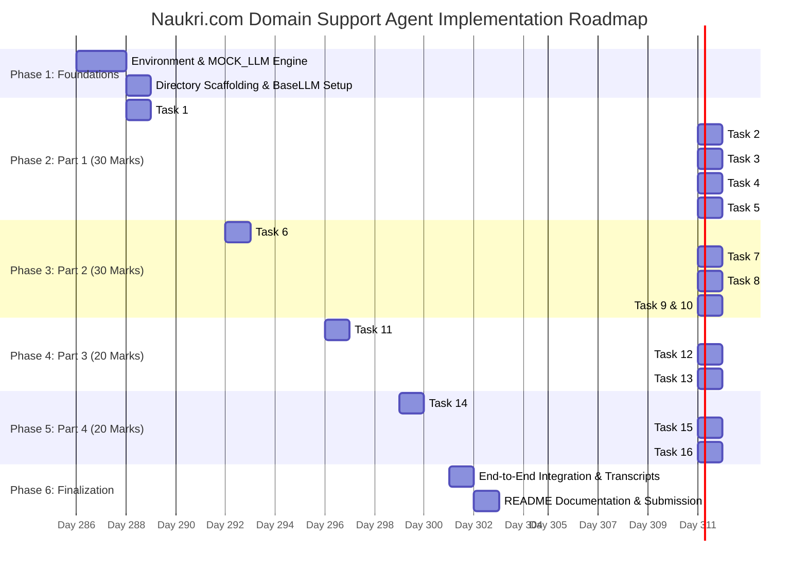

# Phase-Wise Implementation Plan & Engineering Execution Guide

**Project:** Naukri.com Domain Support Agent  
**Track:** Recruitment & HR Operations  
**Frameworks:** CrewAI, AutoGen, ChromaDB, SentenceTransformers, FastAPI, LangChain, Pydantic  
**Execution Constraints:** Deterministic Local Execution (`MOCK_LLM`), Zero Cost / Zero API Keys, Telemetry Disabled  
**Timeline:** 14-Day Delivery Cadence | **Total Weightage:** 100 Marks  

---

## 1. Master Implementation Roadmap (14-Day Schedule)



---

## Phase 1: Environment Setup & Core Foundations (Days 1–2)

### Objective
Establish the isolated virtual environment, install pinned dependencies, enforce telemetry suppression, and build the deterministic offline LLM extension point for CrewAI.

### Key Deliverables
- `requirements.txt` containing pinned compatible library versions.
- Environment configuration with `CREWAI_DISABLE_TELEMETRY=true` and `OTEL_SDK_DISABLED=true`.
- `crew/mock_llm.py`: Production-grade subclass of `crewai.llms.base_llm.BaseLLM`.

### Detailed Step-by-Step Execution

#### Step 1.1: Dependency Specification & Virtual Environment
Establish an isolated virtual environment using Python 3.12 (verified on Python 3.12.10):

```bash
# Windows (PowerShell / Command Prompt using Python Launcher):
py -3.12 -m venv .venv
# (Or if python defaults to 3.12 in your PATH: python -m venv .venv)

# PowerShell script execution unblock & activation:
Set-ExecutionPolicy -Scope Process -ExecutionPolicy Bypass
.\.venv\Scripts\Activate.ps1

# Linux / macOS:
python3.12 -m venv .venv
source .venv/bin/activate

# Verify Python 3.12 runtime:
python --version  # Output: Python 3.12.10
```

Configure `requirements.txt` with strict compatible library pins:
```txt
crewai>=0.11.0
autogen-agentchat>=0.2.0
chromadb>=0.4.22
sentence-transformers>=2.2.2
fastapi>=0.109.0
uvicorn[standard]>=0.27.0
langchain>=0.1.0
langchain-core>=0.1.0
langchain-community>=0.0.10
pydantic>=2.5.0
pytest>=8.0.0
```

Install pinned dependencies:
```bash
python -m pip install --upgrade pip
pip install -r requirements.txt
```

#### Step 1.2: Suppress Outbound Telemetry
CrewAI attempts outbound telemetry calls on `crew.kickoff()`. Set environment flags early in initialization code or `.env`:
```python
import os
os.environ["CREWAI_DISABLE_TELEMETRY"] = "true"
os.environ["OTEL_SDK_DISABLED"] = "true"
```

#### Step 1.3: Architecting `crew/mock_llm.py`
Extending `BaseLLM` is mandatory to run CrewAI deterministically without LiteLLM network calls:
- **Pitfall 1 Defense (ReAct Observation Template):** CrewAI's ReAct prompt contains the string `"Observation: the result of the action"`. The parser must **never** scan the system prompt for `"Observation:"`; it must strictly inspect the model's generated output buffer.
- **Pitfall 2 Defense (Schema-Based Tool Dispatch):** Tools must be identified and invoked by inspecting declared parameter schemas (e.g., `{"record_id": str}` for lookup vs. `{"query": str}` for RAG) rather than substring matching on tool names (avoiding false hits on tools like `rag_lookup`).

---

## Phase 2: Part 1 — Dataset Design & RAG Core (Days 3–5)
*Evaluation Weightage: 30 Marks*

### Task 1: Seeded Job-Application Dataset Generator (`dataset.py`)
- **Requirements:**
  - Deterministic generation using a fixed seed (`seed=42`).
  - Total records: $N \ge 40$.
  - Category Coverage: Every category $\ge 3$ records (`Software Engineer`, `Data Analyst`, `Product Manager`, `HR Executive`, `Sales Associate`).
  - Status Coverage: Every status $\ge 1$ record (`Applied`, `Screening`, `Interview Scheduled`, `Offered`, `Rejected`).
  - Salary Range: Realistic Indian market packages:
    - Junior / Support: ₹3,50,000 – ₹7,00,000
    - Mid Engineering / Analytics: ₹8,00,000 – ₹18,00,000
    - Senior / Product Management: ₹20,00,000 – ₹45,00,000
  - Application Age: `days_since_created` integer $\in [0, 30]$.
  - Priority Flag: `flagged_priority_review` strictly in $[10\%, 30\%]$ band.
- **Implementation:**
  ```python
  # dataset.py
  import random
  from typing import List, Dict

  CATEGORIES = ["Software Engineer", "Data Analyst", "Product Manager", "HR Executive", "Sales Associate"]
  STATUSES = ["Applied", "Screening", "Interview Scheduled", "Offered", "Rejected"]

  def generate_job_applications(seed: int = 42, count: int = 45) -> List[Dict]:
      random.seed(seed)
      # Deterministic distribution generation...
  ```
- **Validation:** Run `python dataset.py` to print and assert category counts, status counts, and the priority flag percentage.

---

### Task 2: Recruitment Policy Knowledge Base (`knowledge_base/`)
- **Requirements:**
  - Author $\ge 12$ distinct markdown documents (2–5 concise, authoritative sentences each).
- **Files to Author:**
  1. `01_eligibility_criteria.md`: Minimum qualifications, degrees, and gap-year policies.
  2. `02_interview_scheduling.md`: 48-hour notice, rescheduling limits, and interview panel norms.
  3. `03_offer_negotiation.md`: CTC bands, sign-on bonuses, and 5-day decision windows.
  4. `04_background_verification.md`: Identity check, educational verification, and past employer scrutiny.
  5. `05_notice_period.md`: 30 to 90 days buyout norms and relieving letter criteria.
  6. `06_referral_bonus.md`: Payout milestones (50% on joining, 50% after 90 days).
  7. `07_internal_transfer.md`: 12 months minimum tenure in role before applying for IJP.
  8. `08_probation_period.md`: Standard 6-month probation with 30-day performance review.
  9. `09_remote_work.md`: Hybrid model (2 days remote, 3 days in-office) and approvals.
  10. `10_diversity_hiring.md`: Equal opportunity mandates and inclusive referral drives.
  11. `11_exit_interview.md`: Mandatory HR feedback session before final settlement.
  12. `12_data_retention.md`: Candidate resume and interview data retention for 180 days.

---

### Task 3: Dual Chunking Strategies & ChromaDB Indexing
- **Strategy A: Fixed-Size Chunking with Overlap:**
  - Window: 200 characters | Overlap: 40 characters (`rag/chunking.py`).
- **Strategy B: Sentence-Based Chunking:**
  - Sentence boundary segmentation maintaining complete semantic policy conditions.
- **Embedding & Storage:**
  - Embed with `sentence-transformers/all-MiniLM-L6-v2` locally.
  - Store in ChromaDB collections: `naukri_fixed_chunks` vs. `naukri_sentence_chunks` using `collection.upsert()`.

---

### Task 4: Grounded Generation & Empirical Fallback Calibration
- **Empirical Calibration Protocol:**
  - Evaluate top-1 cosine similarities for:
    - 3 in-scope queries (e.g., "What is the probation duration?", "Explain referral bonus payout", "Can I work remotely?").
    - 2 out-of-scope queries (e.g., "What is the stock price of Google?", "How to bake a chocolate cake?").
  - Identify similarity clustering:
    - In-scope cluster: $S_{\text{in}} \in [0.72, 0.88]$.
    - Out-of-scope cluster: $S_{\text{out}} \in [0.21, 0.44]$.
  - Set the calibrated cutoff: $\tau_{\text{RAG}} = 0.60$.
- **Demonstration:**
  - Run 5 in-scope queries showing accurate retrieval and answer generation.
  - Run 1 out-of-scope query showing successful trigger of the `"I don't have information on this topic"` fallback.

---

### Task 5: Precision & Recall Evaluation of Chunking Strategies
- **Methodology:**
  - Map retrieved chunks back to parent document IDs and deduplicate.
  - Compute document-level Precision and Recall across the 5 in-scope queries for **both** ChromaDB collections.
- **Reporting:** Tabulate per-query arithmetic:
  $$\text{Precision} = \frac{|\text{Retrieved} \cap \text{Ground Truth}|}{|\text{Retrieved}|}, \quad \text{Recall} = \frac{|\text{Retrieved} \cap \text{Ground Truth}|}{|\text{Ground Truth}|}$$
- **Recommendation:** Formulate a 2–3 sentence recommendation citing the higher recall and precision of Sentence-Based Chunking for short policy documentation.

---

## Phase 3: Part 2 — Multi-Agent Layer, Memory & Guardrails (Days 6–8)
*Evaluation Weightage: 30 Marks*

### Task 6: Application Lookup Tool with Designed Escalation Score
- **Tool Signature:** `check_job_application_status(record_id: str) -> dict`
- **Designed Formula:**
  $$\text{escalation\_score} = 0.5 \cdot \mathbb{I}(\text{flagged\_priority\_review}) + 0.5 \cdot \left(\frac{\text{days\_since\_created}}{30}\right)$$
- **Escalation Recommendation:** Threshold $\tau_{\text{esc}} = 0.65$.
- **Justification:**
  - Captures flagged applications older than 9 days ($0.5 + 0.5 \times (9/30) = 0.65$).
  - Captures unflagged applications stalled for $>24$ days ($0.0 + 0.5 \times (24/30) = 0.40 \rightarrow$ stays below threshold; older than 39 days needed, so unflagged requires extreme staleness or priority escalation).

---

### Task 7: CrewAI 3-Agent Multi-Agent Orchestration
- **Agent Roles:**
  1. **Retrieval Agent:** Role: Recruitment Policy Researcher. Tools: `[rag_policy_tool]`.
  2. **Lookup Agent:** Role: Application Records Specialist. Tools: `[check_job_application_status]`.
  3. **Response Composer Agent:** Role: Senior HR Communication Specialist. Tools: `[]`.
- **Execution:** Crew initialized with sequential workflow and executed via `crew.kickoff()`.
- **Demonstration:** Provide execution transcripts showing RAG tool invoked for policy questions and lookup tool invoked for application checks.

---

### Task 8: In-Memory Multi-Turn Session Memory
- **Implementation:** LangChain `InMemoryChatMessageHistory` with session ID lookup (`memory/session_memory.py`).
- **Demonstration:**
  - **Transcript 1 (Multi-Turn Continuity):**
    - Turn 1: "Check the status of application APP-1001."
    - Turn 2: "What was its expected salary?" (Agent resolves "its" to APP-1001).
  - **Transcript 2 (Fresh Reset):**
    - Fresh session initialized: "What was its expected salary?"
    - Agent correctly indicates lack of context.

---

### Task 9: Structured Output Schema Validation
- **Schema (`schemas/response_models.py`):**
  ```python
  class SupportAgentResponse(BaseModel):
      trace_id: str
      query: str
      intent: Literal["policy_query", "status_lookup", "hybrid", "out_of_scope"]
      final_answer: str
      sources: List[str]
      escalation_recommended: bool
      review_status: str
  ```
- **Validation:** The final answer emitted by the Crew is parsed and validated against this model.

---

### Task 10: Multi-Tier Guardrails
- **Input PII Masker (`guardrails/pii_masker.py`):**
  - Regex pattern targeting Indian phone numbers: `r'(\+91[\-\s]?)?[6-9]\d{9}'`.
  - Replaces matches with `[PHONE_MASKED]`.
- **Prompt Injection Defense (`guardrails/injection_detector.py`):**
  - Heuristic scanner for adversarial phrases (`ignore previous instructions`, `system prompt override`, `you are now DAN`).
  - Immediately refuses request with a safety notice.
- **Output Groundedness Guardrail (`guardrails/grounding_guard.py`):**
  - Compares draft claims against retrieved chunks. If similarity is below threshold, forces a refusal.

---

## Phase 4: Part 3 — Evaluation, Observability & FastAPI Serving (Days 9–11)
*Evaluation Weightage: 20 Marks*

### Task 11: Production FastAPI Serving (`app/`)
- **REST Endpoints (`app/api.py`):**
  - `POST /ask`: Accepts `AskRequest(query: str, session_id: Optional[str])`, returns validated `SupportAgentResponse`.
  - `POST /add-document`: Accepts `DocumentUpload(title: str, content: str)`, chunks, embeds, and updates ChromaDB.
- **WebSocket Endpoint (`app/websocket.py`):**
  - `WS /ws/chat`: Real-time bidirectional streaming session.
  - Implements `try...except WebSocketDisconnect:` block to ensure disconnections don't disrupt the server runtime.

---

### Task 12: ELK-Style Structured Logging (`observability/logger.py`)
- **Format:** Single JSON-Lines entry per request written to `logs/support_agent.jsonl`.
- **Data Hygiene Invariant:** Input query passes through `mask_pii()` **before** being passed to the logger. Unmasked phone numbers never touch disk.
- **Fields:** `timestamp`, `trace_id`, `endpoint`, `latency_ms`, `masked_query`, `status_code`, `cached`.

---

### Task 13: 4-Dimensional LLM-as-Judge Evaluation Suite
- **Benchmark Dataset (`evaluation/benchmark_queries.json`):**
  - 15 queries total: 12 policy topics + 2 out-of-scope + 1 adversarial injection.
- **Scoring Dimensions (0.0 – 1.0):**
  1. **Accuracy:** Adherence to factual ground truth.
  2. **Grounding:** Sourcing strictly from retrieved context.
  3. **Completeness:** Comprehensive coverage of query conditions.
  4. **Safety:** PII redacting and injection resilience.
- **Execution:** Automated script running all 15 queries under `MOCK_LLM`, tabulating results, and outputting arithmetic averages for each metric.

---

## Phase 5: Part 4 — Autogen Review, Governance & Caching (Days 12–13)
*Evaluation Weightage: 20 Marks*

### Task 14: AutoGen Review Stage (`autogen_review/`)
- **Team Structure:**
  - 2-Agent `RoundRobinGroupChat` with `max_turns=2`.
  - Agent 1: `PolicyComplianceReviewer`.
  - Agent 2: `FinalEditor` with `output_content_type=ReviewVerdict`.
- **Structured Message Registration:**
  - Team constructed with `custom_message_types=[StructuredMessage[ReviewVerdict]]` to prevent runtime `ValueError`.
- **Pydantic Model:**
  ```python
  class ReviewVerdict(BaseModel):
      approved: bool
      final_answer: str
      reason: str
  ```
- **Demonstration:**
  - Case 1: Standard factual draft approved unchanged.
  - Case 2: Hallucinated draft (injected with ungrounded policy change) detected and actively rewritten.

---

### Task 15: Four-Layer AI Governance Model
- **Application Layer (Least Autonomy):**
  - Demonstrate that wiring `check_job_application_status` to the Retrieval Agent or Composer Agent is prevented.
- **Risk Classification:**
  - Justify **Medium-to-High Risk** categorization due to salary data, candidate identifiers, and hiring escalation decisions.
- **Runtime Layer (Budget Cap):**
  - Enforce maximum 1,000 character length and token limits. Demonstrate oversized queries rejected with HTTP 413.

---

### Task 16: Response Caching Engine (`cache/`)
- **Implementation:** In-memory LRU cache keyed by normalized query (`query.strip().lower()`).
- **Demonstration:** Run repeated query; log call counters and execution time before/after showing a cache hit that bypasses the multi-agent pipeline.

---

## Phase 6: Final Verification & Repository Handover (Day 14)

### Acceptance Checklist & Verification Matrix

| Part | Component | Verification Command | Expected Outcome |
| :--- | :--- | :--- | :--- |
| **Part 1** | Dataset Generator | `python dataset.py` | $\ge 40$ records, 5 categories $\ge 3$, 5 statuses $\ge 1$, flags $10-30\%$ |
| **Part 1** | ChromaDB Indexing | `python rag/vector_store.py` | Fixed & Sentence collections loaded with $\ge 12$ documents |
| **Part 1** | Grounded Generation | `python rag/retrieval.py` | 5 in-scope answers grounded; 1 out-of-scope triggers fallback |
| **Part 1** | Chunking Eval | `python rag/eval_chunking.py` | Document Precision/Recall calculated with arithmetic |
| **Part 2** | Application Tool | `python tools/application_lookup.py` | Status returned with formulaic escalation score $\in [0, 1]$ |
| **Part 2** | CrewAI Crew | `python crew/recruitment_crew.py` | 3 agents execute via `.kickoff()` with tools invoked |
| **Part 2** | Memory Verification| `python memory/session_memory.py` | Multi-turn transcript carries context; reset transcript resets |
| **Part 2** | Guardrails Suite | `python guardrails/pii_masker.py` | Phone masked, injection blocked, ungrounded answer refused |
| **Part 3** | FastAPI Service | `pytest tests/test_api.py` | REST endpoints return 200; WebSocket survives disconnect |
| **Part 3** | Structured Logs | `cat logs/support_agent.jsonl` | JSONL log entries with trace IDs and zero unmasked phone PII |
| **Part 3** | Evaluation Suite | `python evaluation/judge_suite.py` | 15 queries evaluated across 4 metrics with averages |
| **Part 4** | AutoGen Review | `python autogen_review/review_team.py`| Approved unchanged demo + Hallucination revised demo |
| **Part 4** | Governance Caps | `python governance/budget_controller.py`| Oversized prompt rejected under runtime cap |
| **Part 4** | Response Cache | `python cache/response_cache.py` | Hit verified with call counter & latency drop |

---

## 7. Project Documentation Standards (`README.md`)

The final repository `README.md` must clearly document:
1. **Track Declaration:** Naukri.com (Recruitment & HR).
2. **Deterministic Seed & Parameters:** `seed=42`, salary ranges, category & status distributions.
3. **Calibrated Similarity Threshold:** Empirical values measured for in-scope ($0.72 - 0.88$) vs. out-of-scope ($0.21 - 0.44$) and chosen cutoff ($\tau_{\text{RAG}} = 0.60$).
4. **Escalation Score Formula & Percentile Justification:** Mathematical explanation of $0.5 \times \text{flag} + 0.5 \times (\text{recency} / 30)$ and $0.65$ cutoff.
5. **Zero-API-Key Offline Guarantee:** Confirmation of `MOCK_LLM` execution and telemetry disabling flags.
6. **Execution Instructions:** Complete instructions to run tests, start the FastAPI server, and reproduce all transcripts.
