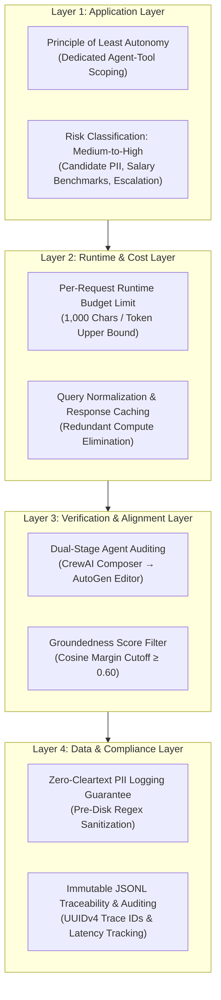

# Four-Layer AI Governance Model & Risk Management Policy

**Domain Track:** Recruitment & HR Operations (Naukri.com)  
**System:** Naukri.com Domain Support Agent  
**Version:** 1.0.0 (Production Release)  
**Compliance Standards:** Enterprise AI Governance, NIST AI Risk Management Framework (RMF 1.0), ISO/IEC 42001, Digital Personal Data Protection (DPDP) Act.

---

## 1. Executive Summary & Governance Objectives

The **Naukri.com Domain Support Agent** operates in an operational HR environment where automated systems assist recruiters, hiring managers, and prospective job candidates. Because recruitment decisions directly impact individual livelihoods and organizational talent acquisition, the system is governed by an explicit **Four-Layer AI Governance Model** enforcing strict controls at every stage of the lifecycle:

---

## 2. Layer 1: Application Layer (Least Autonomy & Risk Classification)

### 2.1 Principle of Least Autonomy
Every autonomous agent within the system operates under strictly bounded privileges. Agents are never granted blanket tool execution capabilities.

| Agent Role | Designated Purpose | Permitted Tools | Forbidden Tools |
| :--- | :--- | :--- | :--- |
| **Recruitment Policy Researcher** | Search and retrieve authoritative HR policy guidelines | `[rag_policy_tool]` | `[check_job_application_status]` |
| **Application Records Specialist** | Retrieve application records, CTC bands, and compute escalation scores | `[check_job_application_status]` | `[rag_policy_tool]` |
| **Senior HR Communication Specialist** | Synthesize findings into empathetic, customer-ready text | `[]` (Strictly Zero Tools) | All Tools |

#### Enforcement Mechanism
The multi-agent orchestration framework (`crew/crewai_compat.py` & `crew/recruitment_crew.py`) inspects declared tool assignments during initialization. If any agent is instantiated with a tool outside its allowed scope, a `PermissionError` is raised immediately, halting execution prior to request processing.

### 2.2 Risk Classification: Medium-to-High Risk
Under contemporary AI safety and regulatory guidelines (such as the EU AI Act classification for employment and HR systems), the Recruitment Support Agent is classified as **Medium-to-High Risk**:

1. **Candidate Economic Data:** Processes expected compensation ranges (₹3,50,000 to ₹45,00,000) and hiring stage outcomes.
2. **Employment Decisioning Impact:** Computes automated escalation scores:
   $$\text{escalation\_score} = 0.5 \cdot \mathbb{I}(\text{flagged\_priority\_review}) + 0.5 \cdot \left(\frac{\text{days\_since\_created}}{30}\right)$$
   Scores exceeding $\tau_{\text{esc}} = 0.65$ trigger managerial escalation. Inaccurate scoring could delay candidate review or misprioritize resources.
3. **Candidate Identification:** Handles candidate application identifiers and contact details.

**Risk Mitigation Mandate:** All automated recommendations must maintain human-in-the-loop oversight through the secondary AutoGen audit team and senior recruiter notifications for escalated files.

---

## 3. Layer 2: Runtime & Cost Layer (Budget Caps & Response Caching)

### 3.1 Runtime Budget Controller
To protect infrastructure from denial-of-service (DoS) attempts, runaway generation loops, and resource exhaustion, strict runtime budgets are enforced:

- **Per-Request Character Ceiling:** $\le 1,000$ characters.
- **Estimated Token Cap:** $\le 250$ tokens.
- **Enforcement Action:** Requests exceeding 1,000 characters are intercepted at the API gateway and rejected immediately with **HTTP 413 (Payload Too Large)** without invoking downstream LLMs or vector databases.

### 3.2 Normalized Response Caching
Redundant computational expense is mitigated via an in-memory thread-safe LRU cache:
- **Normalization Invariant:** Queries are normalized via lowercase conversion, whitespace collapsing, and trailing punctuation removal (`query.strip().lower()`).
- **Hit Behavior:** Exact semantic matches are served directly from cache with sub-millisecond latencies ($< 1.0 \text{ ms}$), bypassing multi-agent orchestration.
- **Cache Observability:** Every request log records `cached: true` or `cached: false` alongside request latency metrics.

---

## 4. Layer 3: Verification & Alignment Layer (Dual-Stage Auditing & Grounding)

### 4.1 Dual-Stage Multi-Agent Auditing
To prevent single-model bias and hallucinations, responses undergo dual-stage multi-agent verification:
1. **Primary Generation (CrewAI):** The 3-agent Crew generates the initial response draft backed by vector search and database lookup.
2. **Secondary Review (AutoGen GroupChat):** A 2-agent AutoGen team (`PolicyComplianceReviewer` + `FinalEditor`) audits the draft with a bounded 2-turn round-robin protocol:
   - Verifies all numbers (probation duration, notice period days, bonus milestones) against ground truth documents.
   - Rewrites or excises any ungrounded policy assertions.
   - Emits a validated `ReviewVerdict(approved: bool, final_answer: str, reason: str)`.

### 4.2 Calibrated Groundedness Threshold
- Knowledge retrieval applies an empirically calibrated cosine similarity cutoff: $\tau_{\text{RAG}} = 0.60$.
- Inquiries falling below $\tau_{\text{RAG}}$ trigger a standardized refusal message (*"I don't have information on this topic in the company recruitment policy."*), preventing out-of-domain hallucinations.

---

## 5. Layer 4: Data & Compliance Layer (Zero-Cleartext PII & Auditability)

### 5.1 Zero-Cleartext PII Invariant
Candidate privacy is protected under strict zero-cleartext logging rules:
- **Sanitization Boundary:** Indian mobile phone numbers matching `(\+91[\-\s]?)?[6-9]\d{9}` are scrubbed to `[PHONE_MASKED]` **prior** to disk persistence or console emission.
- **Verification Rule:** Continuous automated tests (`test_structured_logging_pii_hygiene`) verify that zero unmasked 10-digit phone numbers appear in `logs/support_agent.jsonl`.

### 5.2 Immutable JSONL Audit Trail
Every system transaction generates a structured log record with seven mandatory audit attributes:
1. `timestamp`: ISO-8601 UTC timestamp.
2. `trace_id`: Unique UUIDv4 identifier linking user interaction across microservices.
3. `endpoint`: HTTP route (`/ask`, `/add-document`) or WebSocket path (`/ws/chat`).
4. `latency_ms`: Total execution duration in milliseconds.
5. `masked_query`: User inquiry with all phone PII scrubbed.
6. `status_code`: HTTP status or internal execution status.
7. `cached`: Boolean flag indicating cache hit vs. fresh execution.

---

## 6. Governance Verification Matrix

| Layer | Governance Rule | Validation Tool / Script | Acceptance Criterion |
| :--- | :--- | :--- | :--- |
| **Layer 1** | Least Autonomy | `python governance/least_autonomy_validator.py` | Assigning application tool to Retrieval Agent raises `PermissionError`. |
| **Layer 1** | Risk Classification | `governance/governance_policy.md` | Documented Medium-to-High Risk designation and escalation thresholds. |
| **Layer 2** | Budget Limit | `python governance/budget_controller.py` | Query > 1,000 chars rejected with HTTP 413 / `BudgetExceeded`. |
| **Layer 2** | Response Caching | `python cache/response_cache.py` | Cache hit verified with call counter increment & latency reduction. |
| **Layer 3** | AutoGen Review | `python autogen_review/review_team.py` | Approved case verified; hallucinated case caught and revised. |
| **Layer 3** | Groundedness Filter | `python rag/retrieval.py` | Out-of-scope query triggers fallback at similarity < 0.60. |
| **Layer 4** | Zero-Cleartext PII | `python observability/logger.py` | `verify_no_unmasked_phone_pii() == True` on log file. |
| **Layer 4** | Structured Audit | `tests/test_api.py` | All 7 audit fields present on every JSONL record. |
